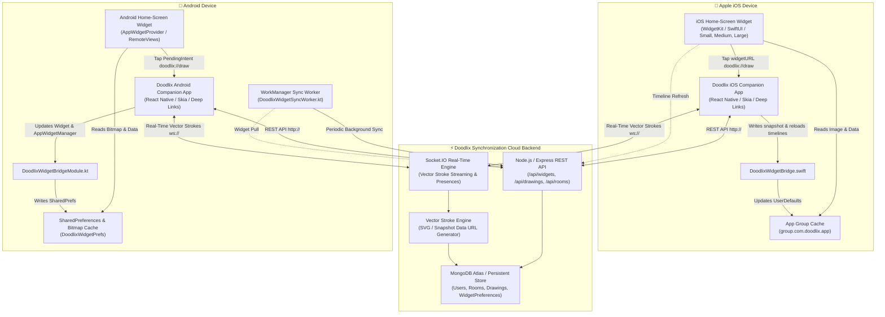

# DOODLIX 🎨
> **"Draw on your screen. Connect through creativity."**

Doodlix is a **widget-first, cross-platform drawing-sharing product**. It is specifically designed to let two people share a drawing experience directly through their phone's home-screen widgets across **iPhone ↔ iPhone**, **Android ↔ Android**, **iPhone ↔ Android**, and **Android ↔ iPhone**.

---

## 📱 System Architecture



---

## 🎨 Brand Identity

| Element | Color Value | Description |
|---|---|---|
| **Primary Purple** | `#7665E8` | Core brand color, action buttons, active strokes |
| **Lavender** | `#EEEAFE` | Widget backgrounds, badges, container cards |
| **Soft Pink** | `#FFDCE8` | Warm romantic accents, alternate widget theme |
| **Background** | `#FAF9FF` | Soft clean canvas backdrop |
| **Text Primary** | `#24213A` | Deep charcoal for readable typography |
| **Border Soft** | `#E8E5F5` | Delicate dividing outlines |

---

## 🚀 Key Features

1. **Home-Screen Widget as the Hero Experience**:
   - Small (`150x150` / `2x2` grid), Medium (`320x150` / `4x2` grid), and Large (`320x320` / `4x4` grid) widgets.
   - Shows friend initials avatar, live connection badge, last updated relative timestamp, and the shared drawing.
   - Tapping the widget executes the deep link `doodlix://draw/:roomId`, directly opening the live shared drawing canvas.

2. **Low-Latency Vector Stroke Synchronization**:
   - Transmits smooth Bézier vector point coordinates over Socket.IO instead of transmitting heavy raster images on every stroke movement.
   - Live peer cursor rendering so users can watch their friend draw simultaneously in real time.
   - Full Undo, Redo, and Clear canvas support with conflict-free vector history.

3. **3-Way Simple Pairing**:
   - **Method A**: 6-digit alphanumeric invite code (e.g. `DLX-PE4MBP`).
   - **Method B**: Native QR Code display and camera viewfinder scanner.
   - **Method C**: Shareable deep link (`https://doodlix.app/invite/:code`).

4. **1-Click Instant Evaluation**:
   - On the Welcome & Login screens, 1-click **"Person A (Android)"** and **"Person B (iPhone)"** profiles allow instant end-to-end pairing without requiring manual email verification.

---

## 📂 Repository Structure

```
dudlix/
├── server/
│   ├── src/
│   │   ├── config/          # MongoDB Atlas & embedded persistent store config
│   │   ├── controllers/     # authController, roomController, drawingController, widgetController
│   │   ├── middleware/      # JWT auth validation middleware
│   │   ├── models/          # MongoDB/Mongoose schemas (User, Connection, Room, Drawing, WidgetPreference)
│   │   ├── routes/          # Express route definitions
│   │   ├── services/        # dataStore (persistent store), strokeEngine (Bézier SVG renderer)
│   │   ├── sockets/         # Socket.IO real-time stroke streaming handler
│   │   └── index.ts         # Server entry point
│   ├── .env.example         # Environment template
│   └── package.json
├── mobile/
│   ├── ios-widget/          # iOS Swift Native Widget Extension
│   │   ├── DoodlixWidget.swift        # WidgetKit provider, Small/Medium/Large SwiftUI layouts
│   │   └── DoodlixWidgetBridge.swift  # React Native bridge to App Groups & WidgetCenter
│   ├── android-widget/      # Android Kotlin Native AppWidget
│   │   ├── DoodlixWidgetProvider.kt   # AppWidgetProvider & layout manager
│   │   ├── DoodlixWidgetBridgeModule.kt # React Native bridge module
│   │   ├── DoodlixWidgetSyncWorker.kt # WorkManager background worker
│   │   └── res/layout/      # doodlix_widget_small.xml, medium.xml, large.xml
│   ├── plugins/             # Expo Config Plugins (withDoodlixWidget, withDoodlixAndroidWidget)
│   ├── src/
│   │   ├── components/      # WidgetPreview, CanvasDrawing, StrokeRenderer
│   │   ├── screens/         # Welcome, Auth, Home, Drawing, Connect, QRScanner, FriendsList, etc.
│   │   ├── services/        # api.ts, socket.ts, widgetBridge.ts
│   │   ├── theme/           # Doodlix brand colors, typography, shadows
│   │   └── navigation/      # AppNavigator with deep linking (doodlix://)
│   ├── app.json             # Expo project configuration with App Groups and deep links
│   └── package.json
└── shared/
    └── types.ts             # Shared TypeScript models, brand colors, socket protocols
```

---

## 🛠️ Getting Started

### 1. Start the Backend Server

```bash
cd server
npm install
npm run build
npm start
```

The backend server starts on `http://localhost:4000`:
- **Widget Endpoint**: `http://localhost:4000/api/widgets/:roomId`
- **Health Check**: `http://localhost:4000/api/health`
- **Real-Time WebSockets**: `ws://localhost:4000`

*(Note: If `MONGODB_URI` is not provided in `server/.env`, the backend automatically runs with an embedded persistent file database in `server/data/db.json` so you can test immediately with zero external dependencies!)*

### 2. Run the Mobile Companion App

```bash
cd mobile
npm install
npm start
```

- Run on iOS Simulator: `npm run ios`
- Run on Android Emulator: `npm run android`
- Run on Web Preview: `npm run web`

---

## 📱 Testing iOS ↔ Android Cross-Platform Sharing

1. **Launch App 1**: Tap **"Person A (Android)"** on the Welcome screen.
2. Tap **"Connect with Friend"** → Doodlix generates room code (e.g. `DLX-PE4MBP`).
3. **Launch App 2**: Tap **"Person B (iPhone)"** on the Welcome screen.
4. Tap **"Enter Code"** → type `DLX-PE4MBP` and tap **"Connect & Link Widgets"**.
5. Both devices are now connected to the private room.
6. Person A draws a heart on the canvas and taps **"📱 Push to Widget"**.
7. Person B's home-screen widget updates immediately with the heart doodle!
8. Person B taps the widget to open the canvas, adds a smiley face, and taps **"Push to Widget"**.
9. Person A's home-screen widget updates with the shared drawing.

---

## 🔒 Security & Data Integrity

- **Private by Default**: Rooms are accessible exclusively by validated members.
- **Stroke Membership Validation**: The WebSocket server verifies room membership before accepting or broadcasting drawing events.
- **Offline Resilience**: If connectivity drops during drawing, strokes are buffered locally and synchronized automatically upon reconnection.
- **JWT Authentication**: Industry-standard cryptographic token security with bcrypt password hashing.

